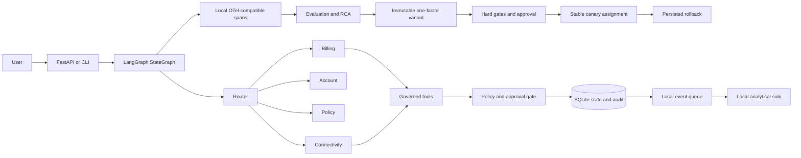

# Architecture

The core is deliberately deterministic. A LangGraph `StateGraph` provides the actual routing and node execution path when dependencies are installed. The model interface is represented by deterministic business logic so the demo is reproducible without a model API.

Every request carries `tenant_id`, `principal_id`, and `correlation_id`. Tool arguments are hashed before trace storage. Writes are checked at the tool boundary rather than trusted from agent text.

The cloud design mirrors local boundaries: FastAPI to Cloud Run, events to Pub/Sub, the worker to Cloud Run, evidence to BigQuery, images to Artifact Registry, and optional model calls to Vertex AI. These are not claimed as deployed.

